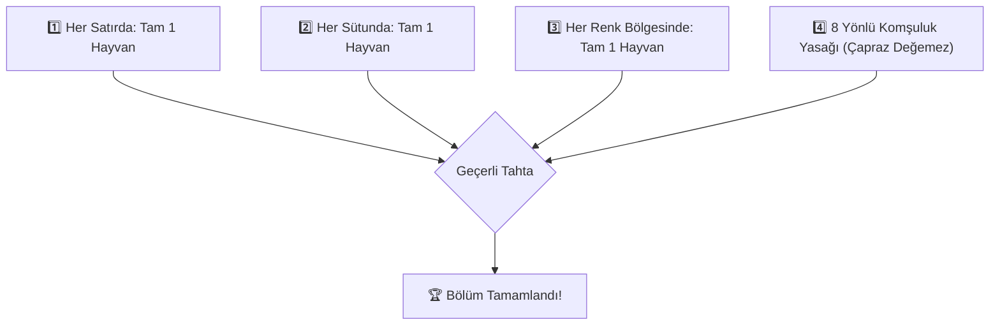
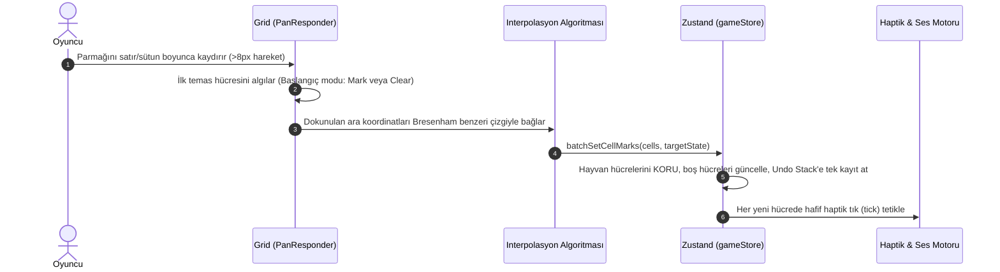
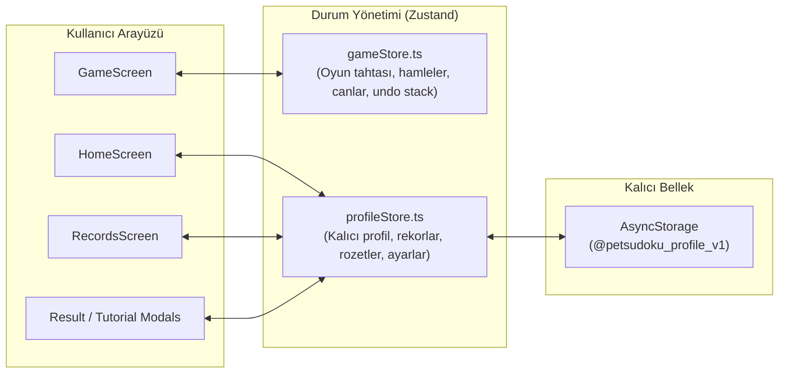

# 🐾 PetSudoku — Kapsamlı Proje & Mimari Dokümantasyonu

> **Sürüm:** 1.0.1 (Build 2)  
> **Platformlar:** Android (Bağımsız APK) & iOS (Apple TestFlight & App Store)  
> **Teknoloji:** React Native 0.88.1, Expo SDK 58, TypeScript (Strict), Zustand  
> **Test Kapsamı:** Jest (30/30 birim testi başarılı)

---

## 📌 İçindekiler
1. [Ürün Genel Bakışı ve Felsefesi](#1-ürün-genel-bakışı-ve-felsefesi)
2. [Oyun Kuralları & Temel Mekanikler](#2-oyun-kuralları--temel-mekanikler)
3. [Gelişmiş Jestler & Etkileşimler (Drag-to-Mark)](#3-gelişmiş-jestler--etkileşimler-drag-to-mark)
4. [Bulmaca Motoru & İnsan Benzeri Mantık Çözücü](#4-bulmaca-motoru--insan-benzeri-mantık-çözücü)
5. [Sistem Mimarisi & Durum Yönetimi (State Management)](#5-sistem-mimarisi--durum-yönetimi-state-management)
6. [Ekran ve Bileşen Hiyerarşisi](#6-ekran-ve-bileşen-hiyerarşisi)
7. [Görsel Tasarım, Haptik ve Ses Motoru](#7-görsel-tasarım-haptik-ve-ses-motoru)
8. [Rozet Vitrini & Başarım Sistemi](#8-rozet-vitrini--başarım-sistemi)
9. [Birim Testleri & Kalite Güvencesi](#9-birim-testleri--kalite-güvencesi)
10. [EAS Cloud Build & Mağaza Dağıtımı (CI/CD)](#10-eas-cloud-build--mağaza-dağıtımı-cicd)
11. [Geliştirici Başlangıç & Komut Kılavuzu](#11-geliştirici-başlangıç--komut-kılavuzu)

---

## 1. Ürün Genel Bakışı ve Felsefesi

**PetSudoku**, klasik $N$-Queens (Vezir) matematiksel bulmacası ile Sudoku'nun bölge bazlı düşünme dinamiklerini sevimli evcil hayvan temasıyla harmanlayan, çocuklardan yetişkinlere her yaş grubuna hitap eden modern bir mobil mantık oyunudur.

### 🌟 Temel İlkeler:
* **Tahmin Değil, Saf Mantık:** Üretilen her bulmacanın **tek ve kesin bir çözümü** vardır. Asla tahmin etmeye veya deneme-yanılma yapmaya gerek yoktur; tüm hamleler tümdengelimsel mantık adımlarıyla kanıtlanabilir.
* **Oyun İçi Dikkati Dağıtmayan Arayüz:** Oyun tahtasında reklam, karmaşık pencereler veya dikkat dağıtıcı öğeler bulunmaz. Pastel tonlar ve sevimli maskotlar odaklanmayı artırır.
* **Pozitif Pekiştirme:** Seviye sonunda interaktif hediye kutusu açma, maskotun ödül mamasını afiyetle yemesi ve rozet kazanımlarıyla oyuncuyu motive eder.

---

## 2. Oyun Kuralları & Temel Mekanikler

Bir PetSudoku tahtası $N \times N$ boyutunda bir ızgara ve $N$ adet renkli bölgeden oluşur ($N \in [5, 9]$).



### Kurallar:
1. **Satır Kuralı:** Her yatay satırda tam olarak 1 adet hayvan bulunmalıdır.
2. **Sütun Kuralı:** Her dikey sütunda tam olarak 1 adet hayvan bulunmalıdır.
3. **Bölge Kuralı:** Her renkli bölgede tam olarak 1 adet hayvan bulunmalıdır. Toplam bölge sayısı tahta boyutuna ($N$) eşittir.
4. **8-Yönlü Komşuluk Yasağı (No Touch Rule):** İki hayvan asla yatay, dikey veya **çapraz** olarak birbirine temas edemez.
5. **Can Sistemi (3 Kalp):**
   - Yanlış bir hücreye hayvan koyulduğunda 1 can kaybedilir ve tahta hatayı kırmızıyla vurgular.
   - 3 can bittiğinde oyun biter (Geri al ve tekrar deneme seçenekleri sunulur).
   - `✕` (Boş Değil) notu koymak **tamamen ücretsizdir** ve asla can götürmez.

---

## 3. Gelişmiş Jestler & Etkileşimler (Drag-to-Mark)

Tek tek hücrelere tıklayarak `✕` koymanın büyük tahtalarda (örneğin 8x8 veya 10x10) zorlaşmasını engellemek amacıyla **PanResponder** tabanlı akıllı sürükleme sistemi geliştirilmiştir:



### Algoritmik Özellikler:
* **Hızlı Kaydırmada Hücre Atlamama (Line Interpolation):** Oyuncu parmağını ekran boyunca hızla kaydırdığında işletim sisteminin kaçırdığı ara koordinatlar interpolasyon ile doldurulur; hiçbir hücre atlanmaz.
* **Hayvanları Koruma:** Sürükleme hareketi daha önce doğru yerleştirilmiş hayvan hücrelerinin üzerinden geçse bile onları asla ezmez ve bozmaz.
* **Akıllı Mod Tespiti:** Sürükleme boş hücreden başladıysa geçtiği yerleri `✕` ile boyar; dolu bir `✕` hücresinden başladıysa boyalı çarpıları silerek temizler (`empty`).
* **Tek Tıkla Geri Al (Batch Undo):** Parmağın tek bir sürükleme hareketiyle koyduğu 10 tane çarpı, `Geri Al` butonuna bir kez basıldığında tek bir hamle olarak geri alınır.

---

## 4. Bulmaca Motoru & İnsan Benzeri Mantık Çözücü

Bulmaca motoru tamamen saf TypeScript ile harici kütüphane bağımlılığı olmadan yazılmıştır (`src/engine/`).

```
src/engine/
├── generator.ts      # Benzersiz çözümlü seviye ve bölge üreteci
├── techniques.ts     # İnsan benzeri 5 kademeli dedüktif mantık kuralları
├── validator.ts      # Hızlı kural denetleyicisi ve hata bulucu
├── solver.ts         # Geri izlemeli (backtracking) kesin çözümleyici
├── rng.ts            # Tohumlu (seeded) deterministik rastgele sayı üreteci
└── types.ts          # Tahta, hücre, evcil hayvan ve durum tipleri
```

### 🧠 İnsan Benzeri Mantık Teknikleri (`techniques.ts`):
1. **Teknik 1 (Simple Row/Col/Region Elimination):** Kesinleşmiş bir hayvanın bulunduğu satır, sütun, bölge ve 8 yönlü çevresindeki tüm adayların elenmesi.
2. **Teknik 2 (Only in Region):** Bir bölgede hayvan konulabilecek yalnızca tek bir boş hücre kalmışsa oraya zorunlu hayvan yerleştirilmesi.
3. **Teknik 3 (Hidden Single):** Bir satır veya sütunda adayı tek kalan hücrenin bulunması.
4. **Teknik 4 (Naked Pair / Overlap):** İki bölgenin adaylarının aynı satır veya sütuna sıkışması sonucu diğer hücrelerin elenmesi.
5. **Teknik 5 (Box-Line Reduction):** Bir bölgenin tüm adaylarının tek bir satırda olması durumunda, o satırın bölge dışındaki tüm adaylarının temizlenmesi.

> [!NOTE]
> Bulmaca üreteci seviyeyi oluşturduktan sonra `solveWithLogic` fonksiyonu ile bulmacayı çözer. Eğer bulmaca sadece bu 5 mantık tekniğiyle (tahmin yapmadan) çözülebiliyorsa ve tek bir benzersiz çözümü varsa oyuna dahil edilir.

---

## 5. Sistem Mimarisi & Durum Yönetimi (State Management)

Uygulama, performans ve hafiflik için **Zustand** durum yönetim kütüphanesini kullanır.



### Veri Tabanı & Geriye Dönük Uyumluluk:
`src/state/profileStore.ts` içinde `safeStorage` mekanizması yer alır. Kullanıcıların daha önce yüklediği sürümlerdeki rekorlarını kaybetmemesi için şu otomatik geçiş mimarisi bulunur:

```ts
let value = await AsyncStorage.getItem(key);
if (value === null && key === '@petsudoku_profile_v1') {
  // Eski sürüm verisi varsa otomatik aktar
  value = await AsyncStorage.getItem('@pedsudoku_profile_v1');
}
```

---

## 6. Ekran ve Bileşen Hiyerarşisi

```
src/
├── screens/
│   ├── HomeScreen.tsx         # Seviye seçimi, maskot durumu, seri ve istatistik özeti
│   ├── GameScreen.tsx         # Oyun tahtası, zamanlayıcı, canlar ve kontrol butonları
│   ├── RecordsScreen.tsx      # Boyut Rekorları tablosu & Rozet Vitrini (Segmented)
│   ├── SettingsScreen.tsx     # Ses, haptik, otomatik işaretleme, "Nasıl Oynanır?" butonları
│   ├── CollectionScreen.tsx   # Maskot mamaları ve ödül koleksiyonu
│   └── PetSelectScreen.tsx    # Kedi (Cat), Köpek (Dog), Tavşan (Rabbit) seçimi
│
├── components/
│   ├── Grid.tsx               # Tahta matrisi, PanResponder sürükleme, dalga animasyonu
│   ├── Cell.tsx               # Tekil hücre, yumuşak köşeli squircle, hayvan emojisi
│   ├── GameHUD.tsx            # Canlar, süre, soru işareti (rehber) ve seviye bilgisi
│   ├── GameActions.tsx        # Geri Al (Undo), Temizle (Clear), İpucu (Hint) butonları
│   ├── ResultModal.tsx        # Hediye kutusu, ödül yeme, rozet bildirimi ve 3 yıldız
│   ├── TutorialModal.tsx      # 4 adımlı görsel onboarding rehberi
│   ├── GameOverModal.tsx      # Can bitişi ve yeniden deneme penceresi
│   └── Hearts.tsx             # 3 adet animasyonlu kalp bileşeni
```

---

## 7. Görsel Tasarım, Haptik ve Ses Motoru

### 🎨 Görsel Palet (Pastel & Ergonomik)
* Gözü yormayan pastel bölge tonları: `Lavanta`, `Nane Yeşili`, `Pastel Pembe`, `Bebek Mavisi`, `Açık Şeftali`, `Limon Sarısı`, `Açık Turkuaz`.
* Bölge sınırları: 2px yumuşak koyu kenarlıklar ile bölgelerin ayrımı anında fark edilir.

### 🔊 Ses ve Haptik Motoru (`src/utils/feedback.ts` & `audioSynthesizer.ts`)
* **Haptik:** `expo-haptics` ile hücreye dokunma, sürükleme, hata yapma ve bölüm bitirme anlarında iOS Taptic Engine ve Android titreşim motoruna hafif darbeler iletilir.
* **Saf PCM Dalga Sentezleyicisi:** Harici ses dosyalarının yüklenemediği ortamlarda dahi matematiksel sinüs dalgaları ile `WAV` tamponu üreten yerel sentezleyici mimarisi mevcuttur.

---

## 8. Rozet Vitrini & Başarım Sistemi

Oyuncu motivasyonunu artırmak amacıyla `src/stats/badges.ts` altında 7 adet rozet tanımlanmıştır:

| Rozet Adı | İkon | Koşul |
| :--- | :---: | :--- |
| **Kusursuz Patiler** | 🎯 | Hiç can kaybetmeden (3 kalp korunarak) bölüm bitirme |
| **Duru Zihin** | 💡 | Hiç ipucu (Hint) kullanmadan bölüm tamamlama |
| **Hızlı Pati** | ⚡ | Bölümü 60 saniyeden kısa sürede tamamlama |
| **3'lü Seri** | 🔥 | Arka arkaya 3 bölüm kazanma serisi yakalama |
| **10'lu Seri** | 🌟 | Arka arkaya 10 bölüm kazanma serisi yakalama |
| **Tüm Boyutlar Ustası** | 👑 | 5x5'ten 9x9'a kadar her boyutta en az bir oyun tamamlama |
| **Büyük Koleksiyoncu** | 🎁 | Toplam 10 veya daha fazla ödül maması biriktirme |

Her oyun bitiminde `checkNewBadges` fonksiyonu çalışarak yeni kazanılan rozeti tespit eder ve `ResultModal` içinde kutlama kartıyla oyuncuya sunar.

---

## 9. Birim Testleri & Kalite Güvencesi

Proje, kritik kuralları ve oyun motorunu doğrulayan kapsamlı Jest testlerine sahiptir:

```bash
npm test
```

* `src/__tests__/engine.test.ts`: Çözücü, üreteç ve mantık algoritmaları doğrulaması.
* `src/__tests__/gameRules.test.ts`: 8 yönlü kural denetimi, satır/sütun çakışmaları, batch mark sürükleme mantığı.
* `src/__tests__/badges.test.ts`: 7 rozetin doğru koşullarda açıldığının simülasyonu.
* `src/__tests__/diffTargets.test.ts`: Farklı boyutlardaki zorluk hedeflerinin tutarlılığı.
* `src/__tests__/bulk.test.ts`: 5x5'ten 9x9'a kadar 100+ bulmacanın çözüm hızı testi (Ortalama çözüm süresi: **1.5ms**).

---

## 10. EAS Cloud Build & Mağaza Dağıtımı (CI/CD)

Proje hem Google Play hem de Apple App Store standartlarına tam uyumludur.

### 🤖 Android Dağıtımı (Standalone APK)
* **Paket Kimliği:** `com.petsudoku.app`
* **Profil:** `preview` (`buildType: "apk"`)
* **Sonuç:** Kullanıcıların doğrudan telefonuna indirip kurabileceği bağımsız `.apk` çıktısı üretir.
* **İndirme Linki:** [PedSudoku_v1.0.1.apk](https://expo.dev/artifacts/eas/fKywW9KkR9PPKEz377ZlRatprG190ADz3rhEq3OT54U.apk)

### 🍏 iOS Dağıtımı (Apple TestFlight & App Store)
* **Paket Kimliği (Bundle Identifier):** `com.petsudoku.app`
* **Profil:** `production` (`distribution: "store"`)
* **Özel Yapılandırma:** `ITSAppUsesNonExemptEncryption: false` (Apple ihracat şifreleme soru engelini otomatik atlar).
* **TestFlight Genel Katılım Linki:** [https://testflight.apple.com/join/AyhG6xfm](https://testflight.apple.com/join/AyhG6xfm)
* **Otomatik Gönderim:** `npx eas-cli build --platform ios --profile production --auto-submit` komutu derleme biter bitmez Apple App Store Connect'e otomatik yükleme yapar.

---

## 11. Geliştirici Başlangıç & Komut Kılavuzu

### 💻 Yerel Geliştirme:
```bash
# Bağımlılıkları yükleme
npm install

# Yerel sunucuyu başlatma
npx expo start

# Mac üzerinde iOS Simülatöründe çalıştırma
npx expo start --ios

# Android emülatöründe çalıştırma
npx expo start --android

# Kod kalite & tip kontrolleri
npx tsc --noEmit
npm test
```

### 📦 Yeni Derleme Alma:
```bash
# Yeni bir Android APK üretmek için:
npx -y eas-cli build --platform android --profile preview

# Yeni bir iOS TestFlight sürümü üretmek ve göndermek için:
npx -y eas-cli build --platform ios --profile production --auto-submit
```

---
*Dokümantasyon son güncelleme: 21 Kasım 2026 — PetSudoku Ekibi*
